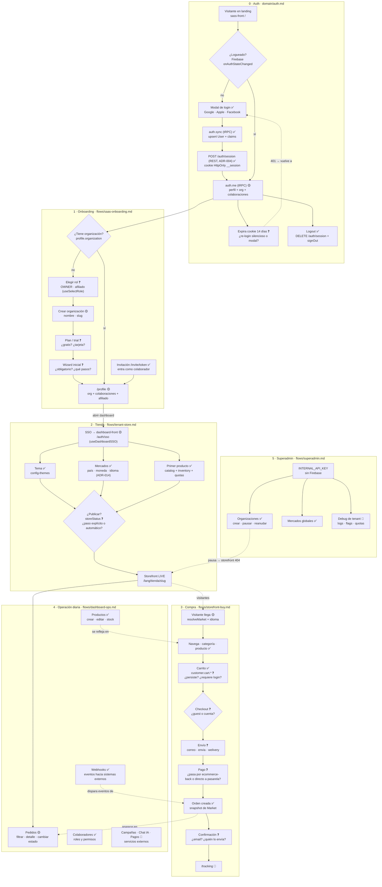

# Mapa de flujos — vista completa del producto

> Índice visual de `flows/`. Cada bloque `[[ ]]` es un archivo a completar.
> Los nodos marcados `?` son decisiones de producto que todavía **nadie definió**:
> son las preguntas que hay que contestar antes de tocar código.
>
> Leyenda: `✅` existe en código · `🟡` existe a medias · `❓` decisión pendiente · `🔲` no existe

## Puntos donde el flujo hoy está roto o ambiguo

| # | Dónde | Problema | Dónde se decide |
|---|---|---|---|
| 1 | `/login`, `/auth/sso`, `/dashboard` en `saas-onboarding.md` | Los flujos describen rutas que **no existen** en sass-front: el login es un modal en el navbar, la pantalla post-login es `/profile` | `auth.md` + `saas-onboarding.md` |
| 2 | A7 | Qué pasa cuando expira `__session` (hoy: 401 silencioso, sin re-login) | `auth.md` |
| 3 | B2 | `isOwner` no existe en el contrato; "dueño" se deduce de `organization !== null` (DT-SF-01) | `saas-onboarding.md` |
| 4 | B4–B5 | Trial, tarjeta, wizard: no hay decisión de producto | `saas-onboarding.md` |
| 5 | C5 | No hay paso "publicar": ¿qué dispara `storeStatus = ACTIVE`? | `tenant-store.md` |
| 6 | D3–D6 | Guest vs cuenta, persistencia de carrito, camino del pago | `storefront-buy.md` |
| 7 | D8–D9 | Email de confirmación y tracking sin dueño | `storefront-buy.md` |
| 8 | E1 | El dashboard no puede cambiar estado de pedido (DT-DASH-01) | `dashboard-ops.md` |

## Orden sugerido para completar

1. `auth.md` (hoy vacío): todo lo demás depende de él.
2. `saas-onboarding.md`: corregir las rutas (punto 1) y definir B2–B5.
3. `tenant-store.md`: decidir el "publicar" (C5).
4. `storefront-buy.md`: es el que más decisiones abiertas tiene.
5. `dashboard-ops.md` y `superadmin.md`.
